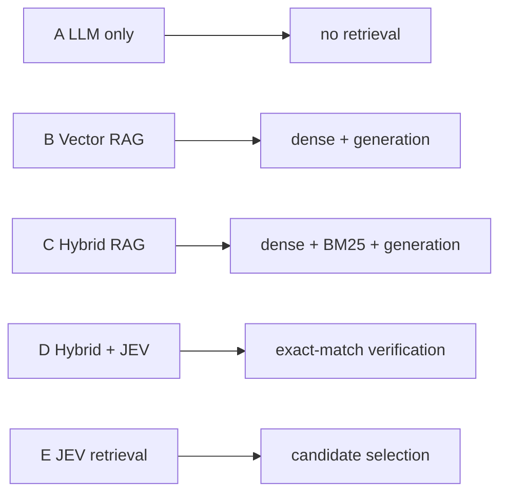

# Final 300-Question Experiment Report

## Research question and hypothesis

Does JEV claim verification improve, match, or worsen Hybrid RAG for scanner-based CVE identification? The hypothesis was that verification could reduce incorrect answers.

## Provenance

- Dataset: [eval_hard_300.jsonl](./data/eval/final/eval_hard_300.jsonl).
- Frozen ranks: [ranks.csv](./data/eval/final/ranks.csv).
- Final predictions: [predictions.csv](./final_eval_20261112T125646Z/predictions.csv).
- The pilot was not reused because compatibility metadata was insufficient; all final rows are marked fresh.

## Arm definitions

| Arm | Definition |
|---|---|
| llm_only | Answer generation without retrieved evidence. |
| vector_rag | Dense retrieval plus answer generation. |
| hybrid_rag | Dense + BM25 fused retrieval plus answer generation. |
| hybrid_jev | Hybrid answer retained only when it exactly matches JEV selection. |
| jev_retrieval | JEV selection from its supplied candidates. |

## Methods

Accuracy = correct / 300.
Wilson 95% interval with z = 1.959963984540054.
McNemar exact two-sided p-value: `p = min(1, 2 * sum(C(b+c, i) for i=0..min(b,c)) / 2^(b+c))` where b and c are discordant paired outcomes.
Unparseable and withheld answers are wrong; provider failures are errors and incorrect for accuracy. Unknown prices and unavailable token counts remain `unknown`.

## Accuracy

| Arm | Correct | Wrong | Error | Accuracy | Wilson 95% CI |
|---|---:|---:|---:|---:|---|
| llm_only | 26 | 274 | 0 | 0.0867 | [0.059829, 0.123956] |
| vector_rag | 247 | 52 | 1 | 0.8233 | [0.776168, 0.862323] |
| hybrid_rag | 249 | 50 | 1 | 0.8300 | [0.783386, 0.868270] |
| hybrid_jev | 244 | 56 | 0 | 0.8133 | [0.765381, 0.853363] |
| jev_retrieval | 262 | 38 | 0 | 0.8733 | [0.830919, 0.906308] |

## Paired tests

| Comparison | b | c | p-value | Accuracy difference | Direction |
|---|---:|---:|---:|---:|---|
| Hybrid RAG vs Hybrid + JEV | 0 | 5 | 0.0625 | -0.0167 | first better |
| Hybrid RAG vs JEV retrieval | 18 | 5 | 0.010622025 | 0.0433 | second better |
| Vector RAG vs Hybrid RAG | 15 | 13 | 0.85055402 | 0.0067 | second better |

## Retrieval, latency, and failure analysis

- Dense, hybrid, and hybrid-reranker ranks and top-1/top-3/top-5 indicators are in [retrieval_analysis.csv](./final_eval_20261112T125646Z/tables/retrieval_analysis.csv), sourced only from frozen `ranks.csv`.
- Latency, token totals, JEV calls, and configured cost are in [latency_usage_cost_by_arm.csv](./final_eval_20261112T125646Z/tables/latency_usage_cost_by_arm.csv). No cost-effectiveness claim is made where prices or token counts are unknown.
- Failure rows: **472**. Categories: `{'wrong_cve': 438, 'unparseable_or_withheld': 32, 'provider_error': 2}`.
- Detailed failures: [failure_cases.csv](./final_eval_20261112T125646Z/tables/failure_cases.csv).

## Observed JEV spend and model-price reference

The completed run made 599 JEV calls: 299 in Hybrid + JEV and 300 in JEV retrieval. The user-reported observed JEV billing total for those calls was **$0.09**. No per-arm invoice split was supplied, so the report does not assign dollar totals separately to Arms D and E. Groq answer-provider billing was not supplied.

### GPT-6 Luna cost estimate (counterfactual)

GPT-6 Luna was used in this experiment. Applying its Standard API rates ($0.10 per million input tokens and $0.50 per million output tokens) to the recorded token usage gives this estimate:

| Arm | Calls / usage basis | Estimated Luna cost |
|---|---|---:|
| D — Hybrid + JEV | 299 recorded answer calls; 236,144 input and 15,057 output tokens | **$0.0311** |
| E — JEV retrieval | 0 answer-model calls; 0 input and 0 output tokens | **$0.03** |

Formula: `(input_tokens × $0.10 + output_tokens × $0.50) / 1,000,000`. Arm D's estimate excludes the provider-error call with no recorded token usage and excludes JEV's separate observed spend. These are hypothetical Luna-rate estimates, not costs incurred in the experiment.

Recorded calls, token usage, and observed JEV spend are in [latency_usage_cost_by_arm.csv](./final_eval_20261112T125646Z/tables/latency_usage_cost_by_arm.csv) and [observed_costs.csv](./final_eval_20261112T125646Z/tables/observed_costs.csv).

## Conclusion

Hybrid + JEV measured lower accuracy than Hybrid RAG in the recorded final results; this run does not support a claim that JEV improves Hybrid RAG. JEV retrieval was higher accuracy than Hybrid RAG, but that is a different arm and should not be interpreted as proof that verification improves Hybrid RAG.

## Limitations

- Scanner-based CVE benchmark scope and finite 300-question sample.
- Provider/model dependence and unknown costs where not configured or recorded.
- Pilot not reused; all final questions were clean reruns.
- Conclusions apply only to this frozen corpus, index, configuration, and benchmark.

## Artifacts

- [final_results.json](./final_eval_20261112T125646Z/final_results.json)
- [run_config.json](./final_eval_20261112T125646Z/run_config.json)
- [stats.json](./final_eval_20261112T125646Z/stats.json)
- [question_level_results.csv](./final_eval_20261112T125646Z/tables/question_level_results.csv)
- [retrieval_analysis.csv](./final_eval_20261112T125646Z/tables/retrieval_analysis.csv)
- [failure_cases.csv](./final_eval_20261112T125646Z/tables/failure_cases.csv)
- [latency_usage_cost_by_arm.csv](./final_eval_20261112T125646Z/tables/latency_usage_cost_by_arm.csv)
- [paired_comparisons.csv](./final_eval_20261112T125646Z/tables/paired_comparisons.csv)
- [observed_costs.csv](./final_eval_20261112T125646Z/tables/observed_costs.csv)

Configured models and retry settings are recorded in [run_config.json](./final_eval_20261112T125646Z/run_config.json); the exact prerequisite test output is [pytest_output.txt](./final_eval_20261112T125646Z/pytest_output.txt). The final run used the frozen corpus hash and index version recorded there.

Additional chart-ready tables: [accuracy_by_arm.csv](./final_eval_20261112T125646Z/tables/accuracy_by_arm.csv), [latency_usage_cost_by_arm.csv](./final_eval_20261112T125646Z/tables/latency_usage_cost_by_arm.csv), [question_level_results.csv](./final_eval_20261112T125646Z/tables/question_level_results.csv), [retrieval_analysis.csv](./final_eval_20261112T125646Z/tables/retrieval_analysis.csv), [paired_comparisons.csv](./final_eval_20261112T125646Z/tables/paired_comparisons.csv), and [failure_cases.csv](./final_eval_20261112T125646Z/tables/failure_cases.csv).
