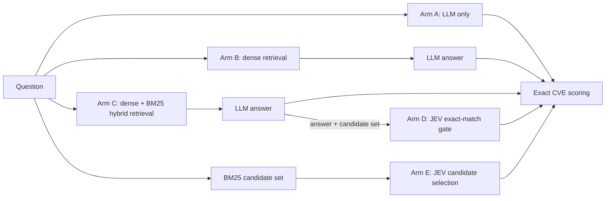
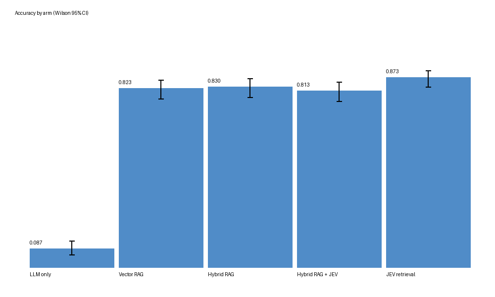
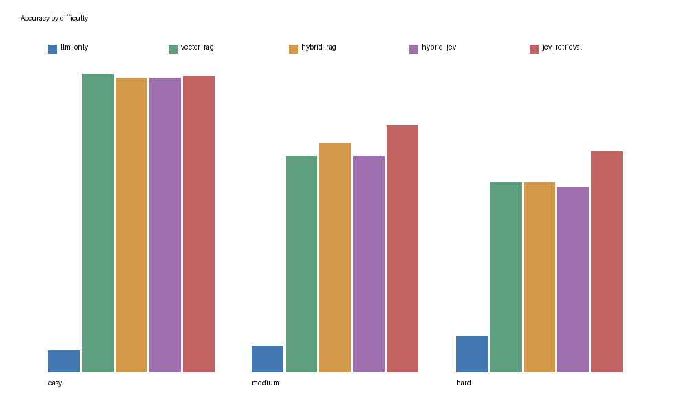
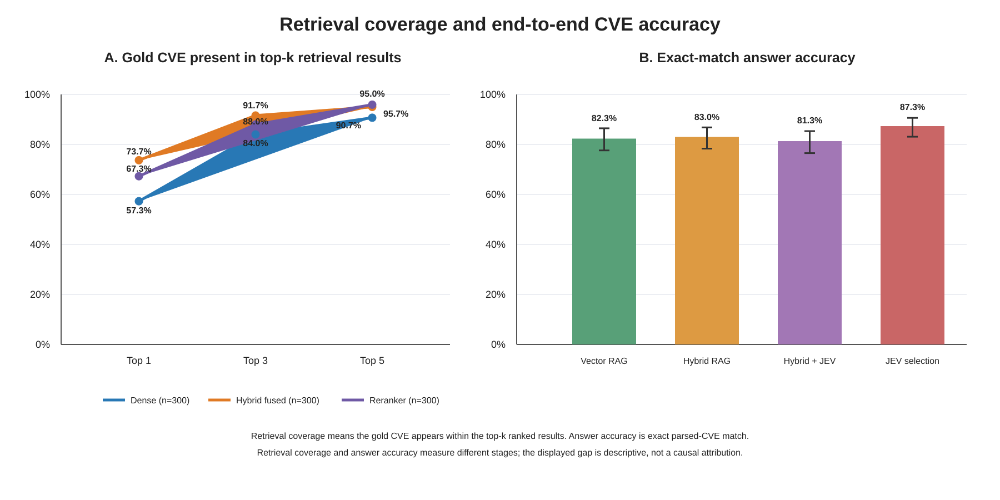

# Retrieval Coverage and JEV Decision Strategies for Scanner-Oriented CVE Identification: A 300-Question Evaluation

## Abstract

This paper evaluates retrieval coverage and two JEV decision strategies for scanner-oriented CVE identification on a frozen 300-question benchmark. Five arms were compared: LLM-only, vector RAG, Hybrid RAG, Hybrid RAG followed by a JEV exact-match gate, and direct JEV candidate selection. Hybrid retrieval placed the gold CVE in its top five results for 285/300 questions (95.0%), while Hybrid RAG achieved 249/300 exact matches (83.0%). Hybrid + JEV achieved 244/300 (81.3%). In the paired comparison, five questions were correct only for Hybrid RAG and none only for Hybrid + JEV; the exact two-sided McNemar p-value was 0.0625. Thus, this run provides no evidence that the tested verification gate improved Hybrid RAG. Direct JEV candidate selection achieved 262/300 (87.3%), but it selected a CVE directly and did not select context for a downstream LLM. The reported JEV spend was $0.09 across 599 calls combined, without a per-arm allocation. The findings apply to this benchmark and configuration and do not establish general superiority of JEV or RAG methods.

**Index Terms?** vulnerability identification, CVE, retrieval-augmented generation, hybrid retrieval, candidate selection, verification.

## 1. Research question

For a fixed scanner-oriented security-CVE benchmark and frozen local corpus,
does adding JEV exact-match verification to Hybrid RAG improve exact CVE
identification accuracy? A secondary comparison asks whether direct JEV
candidate selection differs from Hybrid RAG. The experiment is not intended to
establish a general claim about RAG systems.

## 2. Methods

### 2.1 Dataset and provenance

The evaluation contains 300 questions with unique gold CVEs. The final run is
`final_20261112T125646Z`; all final rows are recorded as fresh clean reruns.
Input validation in [`run_config.json`](./final_eval_20261112T125646Z/run_config.json)
records row-count, uniqueness, no-gold-in-question, hand-check, corpus-hash,
and index-version gates. The question-level outcomes are in
[`question_level_results.csv`](./final_eval_20261112T125646Z/tables/question_level_results.csv).

The corpus hash is
`8c4daa39da534a7f4871f4e4f4d72af03bf8fd3ce5b34e5dac586e11e585f6fc`, and the
frozen index version is
`68e2ecad34e25474fcf5d50c0b14fdcc7b8bf92ea8d4ec5d2347a08e7361a3ea`.

### 2.2 Arms

| Arm | Procedure |
|---|---|
| A: LLM only | Answer generation from the question without retrieved evidence. |
| B: Vector RAG | Dense retrieval, top-five evidence, and answer generation. |
| C: Hybrid RAG | Dense plus BM25 reciprocal-rank fusion, top-five evidence, and answer generation. |
| D: Hybrid + JEV | Reuse C's parsed CVE; retain it only when JEV selects the same CVE from C's Hybrid candidates. |
| E: JEV retrieval | JEV selects one CVE from up to 20 BM25-derived CVE candidates; no answer-model generation in the final path. |

The final-run implementation is in
[`final_runner.py`](./rag_verify_lab/eval_final/final_runner.py); the JEV
selection contract is in [`jev.py`](./rag_verify_lab/verify/jev.py). Retrieval
models ran locally. The recorded answer model was
`openai/gpt-oss-120b` through the Groq-compatible endpoint, and the recorded
JEV model was `jev-latest`.

**Figure 1.** Evaluation arms and scoring flow. Arm D reuses Arm C's generated answer; Arm E selects directly from retrieved candidates.

### 2.3 Metrics

Exact-match accuracy for arm \(a\) was:

\[
\mathrm{Accuracy}_a = \frac{\#\{\text{parsed answer exactly equal to gold CVE}\}}{300}.
\]

Unparseable/blank answers count as wrong. Provider errors are reported
separately and count as incorrect for accuracy. Wilson 95% intervals use
\(z=1.959963984540054\). For paired comparisons, \(b\) is D-correct/C-wrong
and \(c\) is C-correct/D-wrong; the exact two-sided McNemar p-value is
\[
\min\left(1,2\frac{\sum_{i=0}^{\min(b,c)}{b+c\choose i}}{2^{b+c}}\right).
\]

## 3. Results

### 3.1 Main accuracy

**Figure 2.** Exact-match accuracy by arm. Error bars show Wilson 95% confidence intervals. The separate E candidate-selection arm is not the D verification treatment.

| Arm | Correct | Wrong CVE | Blank/invalid | Provider error | Accuracy | Wilson 95% CI |
|---|---:|---:|---:|---:|---:|---|
| LLM only | 26 | 274 | 0 | 0 | 8.6667% | [5.9829%, 12.3956%] |
| Vector RAG | 247 | 51 | 1 | 1 | 82.3333% | [77.6168%, 86.2323%] |
| Hybrid RAG | 249 | 50 | 0 | 1 | 83.0000% | [78.3386%, 86.8270%] |
| Hybrid + JEV | 244 | 25 | 31 | 0 | 81.3333% | [76.5381%, 85.3363%] |
| JEV retrieval | 262 | 38 | 0 | 0 | 87.3333% | [83.0919%, 90.6308%] |

Chart-ready accuracy and difficulty data are in
[`accuracy_by_arm.csv`](./final_eval_20261112T125646Z/tables/accuracy_by_arm.csv),
[`retrieval_analysis.csv`](./final_eval_20261112T125646Z/tables/retrieval_analysis.csv),
and the final-run figure-data CSVs under
[`final_20261112T125646Z/figures`](./final_eval_20261112T125646Z/final_20261112T125646Z/figures).

### 3.2 Paired C-D analysis

The five discordant questions were Q-0426, Q-0442, Q-0476, Q-0569, and
Q-0600. C was correct and D blank on every one. Therefore \(b=0\), \(c=5\),
the accuracy difference D-C was -1.6667 percentage points, and exact
McNemar \(p=0.0625\). The complete recorded paired table is
[`paired_comparisons.csv`](./final_eval_20261112T125646Z/tables/paired_comparisons.csv).

The D rule did not merely detect wrong C answers. It withheld 31 rows:
five were correct C answers and 26 were already wrong C answers. It accepted
25 wrong nonblank CVEs and produced 244 correct answers. There were no
D-correct/C-wrong pairs. The failure table classifies D's blank rows as
`unparseable_or_withheld`, but raw JEV responses and decision labels were not
saved, so the exact cause of each blank cannot be determined.

### 3.3 Difficulty breakdown (optional figure)

**Figure 4.** Accuracy by benchmark difficulty. Use as a supplementary result; the aggregate arm comparison and paired C-D analysis are the primary findings.

### 3.4 Arm E

Arm E achieved 262/300 and 38 wrong-CVE outcomes. It made 300 JEV calls and
zero recorded answer-model calls/tokens in the final usage artifact. It is
direct candidate selection from up to 20 BM25 candidates, not verification of
an answer generated by Hybrid RAG. Its higher accuracy therefore cannot be
used to claim that D improves C.

### 3.4 Failures and retrieval context

Across all five arms, there are 472 incorrect/error rows: 438 wrong CVEs,
32 blank/invalid or withheld answers, and 2 provider errors. Vector RAG has
one blank/invalid response (Q-0594) and one separate provider error. C has 50
wrong-CVE rows and one provider error; D has 25 wrong-CVE and 31
unparseable/withheld rows; E has 38 wrong-CVE rows. The complete cases are in
[`failure_cases.csv`](./final_eval_20261112T125646Z/tables/failure_cases.csv).

**Figure 3.** Retrieval coverage and end-to-end exact-match accuracy. Top-k coverage is descriptive and does not by itself establish the cause of answer errors.

The recorded retrieval analysis is suitable for reporting top-1/top-3/top-5
coverage and the post-retrieval gap, but those coverage values do not change
the exact-match outcome definition.

## 4. Calls, latency, and cost accounting

| Arm | Answer calls | JEV calls | Median latency (ms) | P95 latency (ms) |
|---|---:|---:|---:|---:|
| LLM only | 300 | 0 | 1,103.987 | 2,163.503 |
| Vector RAG | 299 | 0 | 2,545.492 | 5,047.539 |
| Hybrid RAG | 299 | 0 | 2,586.952 | 5,131.536 |
| Hybrid + JEV | 0 new calls; C answer reused | 299 | 800.870 | 1,789.969 |
| JEV retrieval | 0 | 300 | 961.994 | 2,299.178 |

D's latency is verification after C's answer already exists, not a fresh
end-to-end latency for producing C and then verifying it. The recorded
aggregate JEV spend was **$0.09 for 599 calls combined**. No per-arm invoice
split or Groq answer-provider billing was recorded, so no arm-level observed
dollar cost is reported.

GPT-6 Luna was not used. At the reference rates recorded in the existing report
($0.10 per million input tokens and $0.50 per million output tokens), applying
the recorded C/D answer-token basis of 236,144 input and 15,057 output tokens
would yield a **hypothetical** D answer-generation estimate of $0.0311,
excluding JEV. This is not incurred spend and must not be presented as a
measured experiment cost. E has no recorded answer-model token usage in the
final path.

## 5. Limitations and unresolved issues

1. The benchmark is a finite 300-question scanner-oriented CVE set with one
   frozen corpus, index, prompt configuration, and provider setup.
2. Conclusions do not generalize to RAG systems, other corpora, models,
   prompts, or candidate limits.
3. The final artifacts do not contain raw JEV responses, citation probabilities,
   or detailed selection rationale; D's exact-match rule is known, but the
   cause of individual withheld rows is not.
4. `run_config.json` carries an inherited E `answer_calls: 300` value that
   conflicts with the final row-level implementation and usage table. This
   draft uses the latter evidence: 0 answer calls and 300 JEV calls.
5. The $0.09 JEV amount is recorded as user-reported aggregate billing and was
   not independently reconciled or split by arm.
6. The artifact records 30 hand checks as passed but also records the blind
   audit as not run because a predictor was not authorized/configured.

## 6. Conclusion

For this recorded benchmark and configuration, adding the D exact-match JEV
step reduced Hybrid RAG accuracy from 83.00% to 81.33%. All five paired
disagreements favored Hybrid RAG, with exact McNemar p=0.0625. The result does
not support the claim that JEV verification improved Hybrid RAG. Arm E's
87.33% result is a separate candidate-selection finding, not verification
evidence. The observed cost evidence supports only the combined $0.09 JEV
total; Luna-rate numbers are hypothetical estimates.
