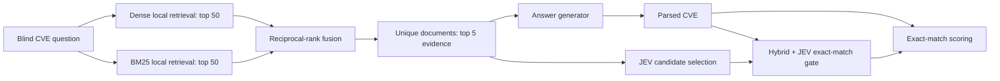

# Paper Lookup: Final 300-Question CVE Identification Experiment

## Use this document for

This is the single lookup document for writing the paper. It distinguishes recorded findings, observed JEV billing, and external price references, and links each claim to its source artifact.

**Final run:** `final_20261112T125646Z`  
**Run timestamp:** 2026-11-12T12:56:48.562024+00:00  
**Questions:** 300  
**Question-arm outcomes:** 1,500  
**Run provenance:** all 300 questions were fresh clean reruns; the earlier pilot was not reused.

## Recommended research question

For scanner-oriented CVE identification with a frozen local security corpus, where does hybrid RAG fail after retrieval, and do JEV decision steps improve answer verification or evidence selection enough to justify their latency and estimated cost?

## Claims supported by this run

1. Retrieval coverage was high: hybrid retrieval placed the gold CVE in its top five for 285/300 questions (95.00%), and reranker retrieval did so for 287/300 (95.67%).
2. Answer generation remained imperfect after retrieval: Hybrid RAG achieved 249/300 exact matches (83.00%), below hybrid top-five coverage.
3. JEV verification did not improve Hybrid RAG: Hybrid + JEV achieved 244/300 (81.33%) compared with 249/300 (83.00%) for Hybrid RAG; exact paired McNemar p = 0.0625.
4. JEV retrieval selection achieved 262/300 (87.33%), exceeding Hybrid RAG by 13 questions; exact paired McNemar p = 0.010622025.
5. The evaluation supports a result about this corpus, index, prompts, model configuration, and candidate set. It does not establish that JEV is generally better than LLMs or RAG.

## Dataset and provenance

| Item | Recorded value |
|---|---|
| Evaluation set | `data/eval/final/eval_hard_300.jsonl` |
| Corpus hash | `8c4daa39da534a7f4871f4e4f4d72af03bf8fd3ce5b34e5dac586e11e585f6fc` |
| Frozen index version | `68e2ecad34e25474fcf5d50c0b14fdcc7b8bf92ea8d4ec5d2347a08e7361a3ea` |
| Dataset gates | 300 rows; unique question IDs; unique gold CVEs; no gold CVE in a question; 30 hand checks passed; corpus and index hashes matched |
| Test suite | 103 passed in 66.93 seconds |

Each evaluation record contains a question ID, question, gold CVE, product, behavior sentence, difficulty label, confusers, corpus hash, and index version. Gold CVEs were used only for post-hoc scoring; they were not passed to retrieval, generation, evidence formatting, or JEV candidate selection.

## System and tools

| Component | Recorded configuration or role |
|---|---|
| Answer model | `openai/gpt-oss-120b` through the Groq OpenAI-compatible API |
| Embedding model | `BAAI/bge-base-en-v1.5`, local |
| Reranker | `BAAI/bge-reranker-v2-m3`, local |
| Decision model | `jev-latest` through the TypeSafe SystemOne endpoint |
| Dense retrieval | cosine-style vector ranking over local embeddings, top 50 candidates |
| Sparse retrieval | BM25 over local corpus text, top 50 candidates |
| Hybrid retrieval | reciprocal-rank fusion of dense and BM25 results, then document-level deduplication |
| Answer evidence limit | top 5 unique documents |
| JEV retrieval candidate limit | top 20 BM25 candidates, then CVE records only |
| Runtime libraries | Python 3.14.5, NumPy 2.4.4, Pillow 12.3.0, FastAPI, SQLAlchemy, rank-bm25, sentence-transformers, OpenAI SDK, HTTPX |

## Experimental flow

### Arm definitions

| Arm | Input | Output path | What it measures |
|---|---|---|---|
| A: LLM only | Question only | Answer model produces one CVE | Model knowledge without corpus evidence |
| B: Vector RAG | Dense top-5 evidence | Answer model produces one evidence-listed CVE | Dense retrieval plus generation |
| C: Hybrid RAG | Dense + BM25 fused top-5 evidence | Answer model produces one evidence-listed CVE | Hybrid retrieval plus generation |
| D: Hybrid + JEV | Arm C answer plus Hybrid top-5 CVE candidates | Retain Arm C CVE only when it exactly matches JEV's selected candidate | JEV answer verification / withholding |
| E: JEV retrieval | Up to 20 BM25 CVE candidates | JEV-selected candidate CVE | JEV evidence selection without LLM answer generation |

The answer prompt required one CVE ID appearing in supplied evidence. JEV received a fixed candidate set containing CVE ID, title, and description and returned a selection from that set. An out-of-set JEV selection was an error.

## Reliability controls

- One heavy experiment job ran at a time through the job queue.
- Three configured answer-provider keys rotated after 401, 403, or 429 responses; each key retained its own Retry-After cooldown.
- Answer calls retried rate-limit failures up to the configured policy; JEV used one bounded retry.
- Answer calls were paced at 24 requests per minute, or 2.5 seconds between starts.
- Unicode dash variants were normalized before CVE parsing.
- An unparseable or withheld non-error response scored as wrong. Provider errors were recorded separately and also counted as incorrect for accuracy.

## Metrics and formulas

### Exact-match accuracy

\[
\mathrm{Accuracy}_a = \frac{\mathrm{correct}_a}{300}
\]

A prediction was correct only when its parsed CVE exactly matched the question's gold CVE.

### Wilson 95% confidence interval

For observed proportion \(\hat p = x/n\), \(n=300\), and \(z=1.959963984540054\):

\[
\frac{\hat p + z^2/(2n) \pm z\sqrt{\hat p(1-\hat p)/n + z^2/(4n^2)}}{1+z^2/n}
\]

### Paired McNemar test

For paired arms, let \(b\) be cases where the second arm is correct and the first is wrong, and \(c\) be cases where the first is correct and the second is wrong:

\[
p = \min\left(1, 2 \times \frac{\sum_{i=0}^{\min(b,c)} \binom{b+c}{i}}{2^{b+c}}\right)
\]

The test is two-sided and exact.

## Main results

| Arm | Correct | Wrong | Provider error | Accuracy | Wilson 95% CI |
|---|---:|---:|---:|---:|---|
| LLM only | 26 | 274 | 0 | 8.67% | [5.98%, 12.40%] |
| Vector RAG | 247 | 52 | 1 | 82.33% | [77.62%, 86.23%] |
| Hybrid RAG | 249 | 50 | 1 | 83.00% | [78.34%, 86.83%] |
| Hybrid + JEV | 244 | 56 | 0 | 81.33% | [76.54%, 85.34%] |
| JEV retrieval | 262 | 38 | 0 | 87.33% | [83.09%, 90.63%] |

## Paired comparisons

| Comparison | b | c | Exact two-sided p | Accuracy difference | Interpretation |
|---|---:|---:|---:|---:|---|
| Hybrid RAG vs Hybrid + JEV | 0 | 5 | 0.0625 | -1.67 percentage points | Hybrid RAG had the higher observed accuracy; not significant at 0.05. |
| Hybrid RAG vs JEV retrieval | 18 | 5 | 0.010622025 | +4.33 percentage points | JEV retrieval had higher accuracy. |
| Vector RAG vs Hybrid RAG | 15 | 13 | 0.850554019 | +0.67 percentage points | No meaningful evidence of a Hybrid RAG improvement. |

## Retrieval coverage

| Retrieval method | Gold top-1 | Gold top-3 | Gold top-5 |
|---|---:|---:|---:|
| Dense | 172/300 (57.33%) | 252/300 (84.00%) | 272/300 (90.67%) |
| Hybrid | 221/300 (73.67%) | 275/300 (91.67%) | 285/300 (95.00%) |
| Hybrid reranker | 202/300 (67.33%) | 264/300 (88.00%) | 287/300 (95.67%) |

This gap between high top-five coverage and lower Hybrid RAG exact-match accuracy is the recorded evidence for a post-retrieval generation/selection bottleneck.

## Latency, calls, and observed JEV spend

| Arm | Median latency | P95 latency | Recorded LLM calls | JEV calls |
|---|---:|---:|---:|---:|---:|
| LLM only | 1,103.987 ms | 2,163.503 ms | 300 | 0 |
| Vector RAG | 2,545.492 ms | 5,047.539 ms | 299 | 0 |
| Hybrid RAG | 2,586.952 ms | 5,131.536 ms | 299 | 0 |
| Hybrid + JEV | 800.870 ms† | 1,789.969 ms† | 299 inherited | 299 |
| JEV retrieval | 961.994 ms | 2,299.178 ms | 0 | 300 |

† Hybrid + JEV latency covers verification after its already-produced Hybrid RAG answer; JEV retrieval latency covers JEV selection. These are not full end-to-end latencies for a hypothetical fresh pipeline that includes any omitted upstream work.

### Cost reporting

- The completed run made 599 JEV calls: 299 in Arm D and 300 in Arm E.
- The user-reported observed JEV billing total for those 599 calls was **$0.09**.
- No per-arm invoice split or Groq answer-provider invoice was supplied. Do not calculate arm-level dollar totals from the aggregate billing amount.
- GPT-6 Luna Standard's published API rate is $0.10 per million input tokens and $0.50 per million output tokens. It was not used in this run, so do not report it as an experiment cost.

## Failure analysis

The final failure table contains 472 incorrect or error question-arm records:

| Category | Count |
|---|---:|
| Wrong CVE | 438 |
| Unparseable or withheld | 32 |
| Provider error | 2 |

Use `failure_cases.csv` to select examples. Report examples with their question ID, arm, gold CVE, returned CVE, retrieval rank, gold-retrieved flag, and failure category. Do not generalize from one example.

## Paper-safe conclusion

On this frozen security-CVE benchmark, JEV verification did not improve Hybrid RAG and produced a lower observed accuracy. JEV candidate selection from up to 20 BM25 candidates produced the highest observed accuracy and a statistically significant improvement over Hybrid RAG. The run's observed JEV spend was $0.09 for 599 total JEV calls; there is insufficient billing data for an arm-level monetary comparison with Groq answer generation.

Do not write that JEV improved RAG in general. Do not write that the result applies to top-5 or top-10 selection: Arm E used up to 20 BM25 candidate records.

## Figures and tables to use

### Publication-ready figures

- Accuracy bars: `../final_eval_20261112T125646Z/final_20261112T125646Z/figures/fig2_accuracy_bar.png`
- Accuracy by difficulty: `../final_eval_20261112T125646Z/final_20261112T125646Z/figures/fig3_accuracy_by_difficulty.png`
- Cost versus accuracy: `../final_eval_20261112T125646Z/final_20261112T125646Z/figures/fig4_cost_vs_accuracy.png`

Do not use the existing cost-versus-accuracy figure as a monetary result. It predates the observed-billing update. A paper figure may instead show **accuracy versus JEV calls** or **accuracy versus latency**.

### Final data files

| Artifact | What to use it for |
|---|---|
| `../final_eval_20261112T125646Z/predictions.csv` | Primary raw per-question, per-arm run output |
| `../final_eval_20261112T125646Z/final_results.json` | Structured full result record and fresh-run provenance |
| `../final_eval_20261112T125646Z/run_config.json` | Models, thresholds, retry policy, and frozen-input gate status |
| `../final_eval_20261112T125646Z/stats.json` | Original aggregate scores and Wilson intervals |
| `../final_eval_20261112T125646Z/pytest_output.txt` | Test evidence: 103 passed |
| `../final_eval_20261112T125646Z/tables/accuracy_by_arm.csv` | Main accuracy table |
| `../final_eval_20261112T125646Z/tables/paired_comparisons.csv` | Statistical-comparison table |
| `../final_eval_20261112T125646Z/tables/retrieval_analysis.csv` | Retrieval coverage and answer-correctness linkage |
| `../final_eval_20261112T125646Z/tables/question_level_results.csv` | All 1,500 question-arm outcomes |
| `../final_eval_20261112T125646Z/tables/failure_cases.csv` | Error taxonomy and case-study selection |
| `../final_eval_20261112T125646Z/tables/latency_usage_cost_by_arm.csv` | Latency, calls, and recorded token usage |
| `../final_eval_20261112T125646Z/tables/observed_costs.csv` | Observed aggregate JEV billing disclosure |
| `../FINAL_EXPERIMENT_REPORT.md` | Short final experiment report |

## Record-keeping note

`run_config.json` has an inherited accounting field that lists 300 `answer_calls` for `jev_retrieval`. The actual final Arm E implementation directly returns JEV's selected CVE and has no recorded answer-model input/output tokens. Use `predictions.csv`, `question_level_results.csv`, and this lookup document for Arm E call accounting: 0 recorded LLM calls and 300 JEV calls.
